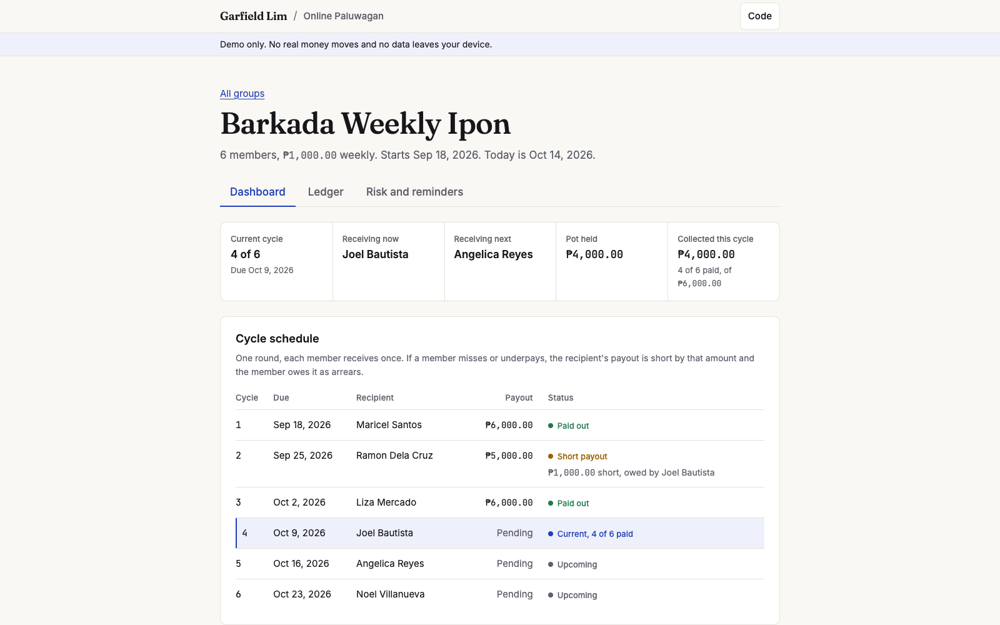
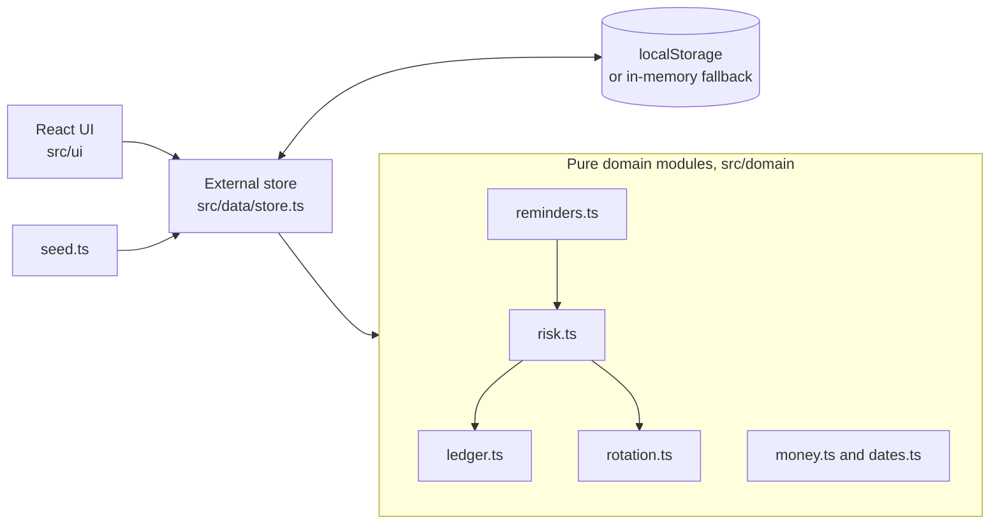

# Online Paluwagan

A rotating savings group manager with a tested money ledger, rule-based risk flags, and pre-written reminder templates a person approves.

[](https://monsieurgregorio2001-coder.github.io/paluwagan/)

> **Disclaimer.** This is a portfolio demo and not a financial service. It does not hold, move, or lend money. All data stays in your browser. Reminder drafts are pre-written templates and nothing is ever sent.

## In 30 seconds

- **Problem:** Paluwagan groups run on chat threads and memory, so late payments and disputes are common.
- **Build:** Append-only ledger in integer centavos, seeded payout draw, rule-based risk flags, and pre-written reminder templates a person approves, in English and Filipino.
- **Result:** the test and eval counts are written by CI into `evidence.json` and shown on the page under Receipt.

**Live demo:** https://monsieurgregorio2001-coder.github.io/paluwagan/

## What is a paluwagan?

A paluwagan is a Filipino savings circle. Members contribute a fixed amount each cycle, and one member receives the whole pot until everyone has been paid once per round.

## Features

- A demo label on every screen, and the house crumb and footer (house 2.0.1, pinned in `house.lock.json`).
- **Check the books, then try to cheat them.** The ledger, the cycle state and each member's stub are written together. The check compares them cycle by cycle, and a forged line on your own copy is caught.
- Reminder inbox (Draft, Approved, Sent simulated) with a confirm dialog, scored by `npm run eval:reminders`.
- Two seeded groups (6 members weekly at PHP 1,000 and 10 members monthly at PHP 5,000), always mid-round with late and missed payments. Seeds are generated relative to today.
- Create a group with members, amount, frequency, start date, and a manual or seeded payout order. The seed is shown so the draw can be checked.
- Dashboard with current cycle, who receives now and next, pot held, amount collected, and a dated schedule.
- **Short payouts and arrears.** When a member misses or underpays, the recipient's payout is short. The schedule shows "Short payout" with the shortfall, and the member owes it as arrears.
- Ledger with on-time, late, and missed contributions, payouts, arrears payments, and reversals.
- Risk flags (Low, Medium, High) from late days and missed cycles, with the reasons shown.
- Reminder drafts in English and Filipino (polite, firm, final). Edit, then Approve, then Send. Send is simulated.
- Light and dark themes, PHP formatting, and Asia/Manila dates through `Intl`.

## Architecture



The UI never does money math. It calls pure domain functions that the tests cover. The store applies the result and saves it. There is no backend and no network call.

## Money-safety design decisions

- **Integer centavos.** Money is always a whole number of centavos, with no floats in the domain. Text such as `1,000.50` is parsed with string and integer math.
- **Append-only ledger.** Entries get a sequence number and timestamp and are never edited or removed. The tests assert that earlier entries stay untouched.
- **Reversing entries.** A mistake is fixed by appending a reversal with a reason. A reversal cannot be reversed, and an entry cannot be reversed twice.
- **Short payouts and arrears.** A missed or short contribution records its shortfall on the entry itself. The member owes that amount as arrears. The recipient's payout is limited to what the pot holds, so it is short by the same amount.
- **Settling arrears.** "Record arrears payment" appends an `arrears` entry. It counts as a contribution. If the cycle payout was already made, it also counts as a payout to the recipient, so the pot does not change. Otherwise the money stays in the pot until the payout.
- **Arrears never go negative.** A payment larger than the amount owed is rejected. So is any reversal or later entry that would leave more settled than owed.
- **Invariant.** Net contributions always equal net payouts plus the pot balance, and the pot never goes negative.
- **Human in the loop.** A reminder cannot be sent until a person approves it, and it cannot be edited after approval.

## Run locally

```bash
npm install
npm run dev        # development server
npm test           # vitest
npm run build      # type check and production build into dist/ (needs HOUSE_DIR, a checkout of the hub)
npm run eval:reminders
npm run preview    # serve the build at http://localhost:4173/paluwagan/
```

Node 18.20 or newer works. The app is served under the `/paluwagan/` base path.

## Tests and measured results

- **Vitest:** 53 tests in 6 files, all passing. The ledger property test runs 12,000 random operations (40 seeds, 300 each) across contributions, payouts, arrears payments, and reversals. After every step it checks reconciliation, a non-negative pot, non-negative arrears, and append-only behavior. Other tests cover the seeded payout draw, risk levels, reminder templates, seed data, and currency formatting.
- **Build:** gzipped initial load is about 65.9 kB (JS 61.2 kB, CSS 4.1 kB, HTML 0.6 kB). Self-hosted fonts load separately and only the subsets in use are fetched.
- **Accessibility:** axe finds no WCAG 2.1 AA violations on any route in light and dark themes. No horizontal page scroll at 360 px.

## Credits

Built by Garfield Greg Lim III. [Portfolio](https://monsieurgregorio2001-coder.github.io/). Fonts: Fraunces and Inter from the house layer, under the SIL Open Font License.

## Development conventions

Start with [local project context](docs/CONTEXT.md) and [agent instructions](AGENTS.md). Shared structure, review, and spec practices live in the [portfolio hub repository](https://github.com/monsieurgregorio2001-coder/monsieurgregorio2001-coder.github.io), under CONTRIBUTING.md and docs/portfolio/. Small fixes use a short verification record; material behavior changes use a focused spec.

## License

MIT. Copyright (c) 2026 Garfield Greg Lim III.
