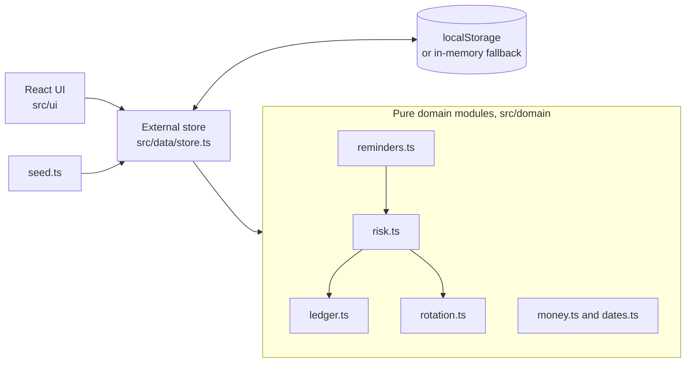

# Online Paluwagan

A browser-only demo of a rotating savings group manager with a tested money ledger, rule-based risk flags and human-approved reminder drafts.

> **Disclaimer.** This is a portfolio demo and not a financial service. It does not hold, move, lend or transfer money. All data stays in your browser. The reminder drafts are pre-written templates and nothing is ever sent.

## What is a paluwagan?

A paluwagan is a Filipino rotating savings group. Members contribute a fixed amount each cycle and one member receives the whole pot each cycle until everyone has been paid once per round.

## Features

- Persistent demo banner on every screen.
- Two seeded groups (6 members weekly at PHP 1,000 and 10 members monthly at PHP 5,000), mid-round with late and missed payments. Seeds are generated relative to today so the demo is always mid-round.
- Create a group: name, members (add, remove, reorder with Up and Down buttons), amount in PHP, weekly, biweekly or monthly frequency, start date, and payout order that is manual or randomized with a visible seed so the draw can be checked.
- Dashboard: current cycle, who receives the pot now and next, pot balance, collected amount, and a dated cycle schedule.
- Ledger: record on-time, late (with date) and missed contributions and payouts. Entries are append-only with timestamps and corrections are reversing entries.
- Risk flags: Low, Medium or High per member from late days and missed cycles, with the reasons shown.
- Reminder drafts in English and Filipino (polite, firm, final), labeled "Drafted by Claude (pre-generated for this demo)". Edit, then Approve, then Send. Send is simulated and moves the message to a Sent log.
- Reset demo data button. If localStorage is unavailable the app falls back to memory and says so.
- PHP formatting and Asia/Manila dates through `Intl`. Light and dark themes through CSS custom properties.

## Architecture



The UI never does money math. It calls the domain functions, which are pure and covered by tests. The store applies the result and saves it. There is no backend and no network call.

## Money-safety design decisions

- **Integer centavos.** Money is always a whole number of centavos. There are no floats anywhere in the domain. User text such as `1,000.50` is parsed with string and integer math, and formatting splits pesos from centavos before using `Intl.NumberFormat('en-PH')`.
- **Append-only ledger.** Entries get a sequence number and timestamp and are never edited or removed. Every operation returns a new array and the tests assert that earlier entries are untouched.
- **Reversing entries.** A mistake is corrected by appending a reversal that points at the original and carries a reason. A reversal cannot itself be reversed and an entry cannot be reversed twice.
- **Invariant.** Net contributions always equal net payouts plus the pot balance. The pot can never go negative: payouts above the balance and reversals that would overdraw the pot are rejected.
- **Human in the loop.** A reminder cannot be sent until a person approves it, and it cannot be edited after approval.

## Roadmap

v1.1: Fly.io API proxying live Claude calls with a monthly spend cap and rate limit.

## Run locally

```bash
npm install
npm run dev        # development server
npm test           # vitest
npm run build      # type check and production build into dist/
npm run preview    # serve the build at http://localhost:4173/paluwagan/
```

Node 18.20 or newer works (Vite 5, Vitest 2). The app is served under the `/paluwagan/` base path. `.github/workflows/deploy.yml` deploys to GitHub Pages with `actions/deploy-pages`.

## Test results

- Vitest: 44 tests in 6 files, all passing. Covers ledger reconciliation with reversals using randomized property-style runs (40 seeds, 300 operations each), append-only behavior, rotation fairness and seed determinism, risk levels for fixture members, reminder templates (no leftover placeholders, approval flow), seed data, and currency formatting (`100000` centavos gives `₱1,000.00`).
- Build: gzipped initial load is about 60.7 kB in total (JS 58.3 kB, CSS 1.9 kB, HTML 0.5 kB).
- Lighthouse (mobile preset, against `vite preview`): Performance 100, Accessibility 100, Best Practices 100, SEO 100.
- Checked at 360 px wide: no horizontal page scroll on any screen.

## License

MIT. Copyright (c) 2026 Garfield Greg Lim III.
